<picture>
  <source media="(max-width: 600px) and (prefers-color-scheme: dark)" srcset="assets/hero-mobile-dark.svg">
  <source media="(max-width: 600px)" srcset="assets/hero-mobile-light.svg">
  <source media="(prefers-color-scheme: dark)" srcset="assets/hero-dark.svg">
  
</picture>

  <a href="https://www.linkedin.com/in/a-e-m2024/">LinkedIn ↗</a> &nbsp; / &nbsp;
  <a href="https://github.com/WinchesterxZ?tab=repositories">Explore my repositories ↗</a>

### The person behind the handle

I'm **Ahmed**, a Computer Science graduate from Benha University, working across **penetration testing, security operations, and mobile development**.

My background spans Android apps, Windows environments, and IT support. These days, that experience comes together in web, mobile, and Active Directory security testing, alongside hands-on SOC training. I like the space where understanding how something is built helps explain how it can fail.

**Build it. Trace it. Understand it.**

### 01 / On the workbench

Three public repositories that show different sides of my work. The mobile apps are learning and development projects; descriptions reflect the code and documentation in each repository.

#### [ReconX ↗](https://github.com/WinchesterxZ/reconx)

A **Go reconnaissance framework** with a staged pipeline for subdomains, live hosts, ports, URLs, JavaScript analysis, and vulnerability scanning. Includes scope handling, resumable output, and HTML / JSON reports.

Go · CLI tooling · Reconnaissance automation

#### [Food Planner ↗](https://github.com/WinchesterxZ/Food-Planner)

An **Android meal-planning app** with search, saved meals, weekly plans, and Firebase backup. Room keeps saved content available offline; Retrofit connects the app to TheMealDB.

Kotlin · MVVM · Room · Firebase · Retrofit

#### [CryptoTracker ↗](https://github.com/WinchesterxZ/CryptoTracker)

An **Android learning project** exploring market data, price history, and adaptive list / detail screens with Jetpack Compose. The code uses Ktor for networking and Koin for dependency injection.

Kotlin · Jetpack Compose · Ktor · Koin

### 02 / My working kit

- **Application security:** Web and mobile testing, OWASP Top 10, Burp Suite, ffuf, Frida, JADX.
- **Networks & identity:** Nmap, Wireshark, Active Directory testing, BloodHound, Impacket.
- **Security operations:** Security monitoring, alert investigation, SIEM, incident response workflows.
- **Building & automation:** Python, Kotlin, Java, Dart, Jetpack Compose, Firebase, Linux, Git, Docker, Bash.

### 03 / Field experience

**Cyber Security Analyst Intern · Telecom Egypt**  
August 2026 – present  
Participating in SOC monitoring and alert investigation, with guidance from senior analysts.

**IT Operations Specialist · Samco National Construction Company**  
February 2026 – present  
Supporting users, provisioning devices, and maintaining IT assets.

**Penetration Testing Trainee · We Innovate Academy & ZeroSploit**  
November 2025 – January 2026  
Practical web, mobile, and network testing in simulated assessment environments.

Earlier experience &amp; learning

**IT Support Specialist · National Company for Telecommunication Services**  
May 2024 – July 2025. Windows domain support, patch compliance, access control, and troubleshooting.

**Completed learning**

- Hack The Box — Web Penetration Tester path, 100% completion. This is training-path completion.
- TryHackMe — Advent of Cyber 2025, including Advanced Side Quests.
- Google — Cybersecurity Professional Certificate and IT Support Professional Certificate.
- Meta — Android Developer Professional Certificate.

  <b>Code, systems, and the questions in between.</b> 
  Ahmed Emad · WinchesterxZ  
  <a href="https://www.linkedin.com/in/a-e-m2024/">Let's connect ↗</a>

